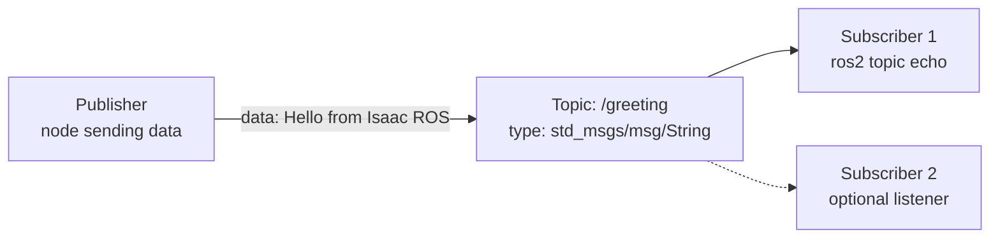

<p align="center">
  
</p>

# Isaac ROS Home Lab

> Build a GPU-accelerated ROS 2 playground at home—from a clean Ubuntu installation to your first publisher and subscriber.

A practical guide to setting up **NVIDIA Isaac ROS** on a dedicated Ubuntu machine and completing a first ROS 2 communication exercise.

## Learning roadmap

This repository is both a reproducible home-lab setup and a growing, hands-on ROS 2 course. Start with the environment, then complete the labs in order.

The infrastructure setup follows the original Ubuntu + SSH + Docker + Isaac ROS + VNC checklist. The hands-on tasks are an additional learning track built on top of that prepared environment; they are not copied from the original setup document.

| Phase | Tasks | Outcome | Status |
|---|---:|---|:---:|
| Environment | 00 | Ubuntu, NVIDIA, Docker, Isaac ROS, SSH, and VNC | ✅ |
| ROS 2 foundations | 01–04 | Custom communicating Python nodes launched as one application | In progress |
| Robot fundamentals | 05–08 | A visible and keyboard-controlled wheeled robot | Planned |
| Simulation and sensors | 09–11 | A robot driving inside a simulated warehouse | Planned |
| Autonomous navigation | 12–15 | Mapping, localization, path planning, and obstacle avoidance | Planned |
| Warehouse autonomy | 16–18 | Missions, recovery behavior, and task execution | Planned |
| Isaac ROS perception | 19–21 | GPU-accelerated camera perception and object detection | Planned |
| Capstone project | 22 | An autonomous warehouse robot demonstration | Planned |

The complete curriculum, learning outcomes, and capstone specification are available in the **[full project roadmap](ROADMAP.md)**.

Current labs:

| Task | Lab | What you will build | Status |
|---:|---|---|:---:|
| 01 | [ROS 2 communication basics](#first-exercise-publisher-topic-and-subscriber) | A CLI publisher and subscriber connected through a typed topic | ✅ |
| 02 | [Python temperature publisher](TASK-02-TEMPERATURE-PUBLISHER.md) | A custom `rclpy` node publishing simulated server temperatures | ✅ |
| 03 | [Temperature monitor subscriber](TASK-03-TEMPERATURE-MONITOR.md) | A subscriber with logging and a configurable warning threshold | ✅ |
| 04 | Launch files and YAML parameters | One command that starts and configures the complete monitor | Planned |

### Quick navigation

- [Requirements](#requirements)
- [Quick installation](#quick-installation)
- [Verify the installation](#verify-the-installation)
- [Connect over SSH](#connect-over-ssh)
- [Start Isaac ROS](#start-isaac-ros)
- [Task 01: publisher, topic, and subscriber](#first-exercise-publisher-topic-and-subscriber)
- [Task 02: Python temperature publisher](TASK-02-TEMPERATURE-PUBLISHER.md)
- [Task 03: Temperature monitor subscriber](TASK-03-TEMPERATURE-MONITOR.md)
- [Full learning roadmap](ROADMAP.md)
- [Troubleshooting](#troubleshooting)
- [Hands-on labs](#hands-on-labs)

Typical setup:

- **server**: an Ubuntu machine with an NVIDIA GPU running Docker and Isaac ROS;
- **client**: a laptop or another computer connected to the server over SSH;
- **VNC**: optional remote desktop access for RViz and other GUI applications.

> [!IMPORTANT]
> Isaac ROS evolves quickly. This guide targets Isaac ROS 5.0 and was verified in October 2026. Check the [current NVIDIA documentation](https://nvidia-isaac-ros.github.io/getting_started/) before a new installation.

## Requirements

### Server hardware

- x86_64 processor;
- NVIDIA GPU with Ampere or newer architecture;
- at least 8 GB of GPU memory;
- at least 32 GB of free storage, with 100 GB or more recommended;
- internet access for packages and Docker images.

Hardware used in this home lab:

```text
GPU: NVIDIA GeForce RTX 4070, 12 GB VRAM
Disk: 289 GB free
```

### Server software

- **Ubuntu 24.04 LTS**;
- NVIDIA driver **595 or newer**;
- Docker Engine;
- NVIDIA Container Toolkit;
- Isaac ROS CLI;
- OpenSSH Server for remote access;
- optionally, GNOME Remote Desktop and a VNC client.

Ubuntu 26.04 is not officially supported by this configuration. See [NVIDIA Isaac ROS Getting Started](https://nvidia-isaac-ros.github.io/v/release-5.0/getting_started/index.html) for the current Isaac ROS 5.0 requirements.

## Quick installation

This repository contains an idempotent `setup.sh` script that can be run repeatedly. On a fresh Ubuntu 24.04 installation, it installs the system dependencies, NVIDIA driver, SSH, Docker, NVIDIA Container Toolkit, Isaac ROS CLI, and optionally VNC.

```bash
git clone <THIS-REPOSITORY-URL>
cd <REPOSITORY-NAME>
chmod +x setup.sh
./setup.sh
```

Run the script as a regular user, not as `root`. It requests elevated permissions through `sudo` when required.

Reboot after the NVIDIA driver installation:

```bash
sudo reboot
```

Run the script again after the reboot. It skips stages that are already complete.

You can also run selected stages only:

```bash
./setup.sh docker isaac
```

Available stages:

```text
base  driver  ssh  docker  isaac  vnc  verify
```

### Optional environment variables

| Variable | Purpose |
|---|---|
| `HARDEN_SSH=1` | Disables password authentication; use only after verifying SSH key access. |
| `VNC_PASSWORD=...` | Sets the VNC password; otherwise the script prompts for it. |
| `ISAAC_ROS_RELEASE=release-5.0` | Pins the Isaac ROS apt repository to a specific release. |
| `NVIDIA_DRIVER_PKG=...` | Forces a particular NVIDIA driver package. |
| `FORCE=1` | Allows execution on a system other than Ubuntu 24.04; not recommended. |

## Verify the installation

Run the following commands on the server:

```bash
echo "=== SYSTEM ==="
lsb_release -ds
df -h ~

echo "=== GPU ==="
nvidia-smi

echo "=== DOCKER ==="
docker --version
docker info | grep -E "Runtimes|Default Runtime"
docker run --rm --gpus all ubuntu:24.04 nvidia-smi

echo "=== ISAAC ROS ==="
command -v isaac-ros
```

The expected result is Ubuntu 24.04, a supported NVIDIA GPU, driver 595 or newer, the `nvidia` runtime listed by Docker, and a path to the `isaac-ros` command.

## Connect over SSH

Find the username and IP address on the server:

```bash
whoami
hostname -I
```

Run the following commands on the client computer:

```bash
ssh-keygen -t ed25519 -C "homelab"
ssh-copy-id user@SERVER_IP
ssh user@SERVER_IP
```

After key-based login works, SSH can be hardened on the server:

```bash
HARDEN_SSH=1 ./setup.sh ssh
```

Before disabling password authentication, verify the key in a second terminal and keep one working SSH session open.

## Start Isaac ROS

The default workspace on the host is:

```text
/home/<user>/workspaces/isaac_ros-dev
```

The same data is available inside the container at:

```text
/workspaces/isaac_ros-dev
```

Start the container, or attach to it if it is already running:

```bash
isaac-ros activate
```

Verify the active environment:

```bash
whoami
pwd
echo "$ROS_DISTRO"
ls /opt/ros
ros2 --help
```

With Isaac ROS 5.0, the expected user is `admin`, the workspace is `/workspaces/isaac_ros-dev`, and the ROS 2 distribution is `lyrical`.

Every new SSH terminal starts on the Ubuntu host. Run `isaac-ros activate` in each terminal where you want to use the Isaac ROS environment.

## First exercise: publisher, topic, and subscriber

<p align="center">
  
</p>

A ROS 2 application consists of nodes that communicate with one another. A publisher sends messages to a named topic, while a subscriber receives messages from that topic.



- A **publisher** creates and sends messages.
- A **topic** is a named communication channel, in this example `/greeting`.
- A **subscriber** receives messages from a topic.
- The **message type** defines the data structure, here `std_msgs/msg/String` with a `data` field.
- The **subscriber count** changes dynamically according to how many nodes are currently listening.

### Terminal 1: publisher

Connect over SSH, activate Isaac ROS, and start a publisher:

```bash
isaac-ros activate
ros2 topic pub --rate 1 /greeting std_msgs/msg/String "{data: 'Hello from Isaac ROS'}"
```

The publisher now sends one message per second.

### Terminal 2: subscriber

Open a second SSH connection, attach to the same container, and listen for messages:

```bash
isaac-ros activate
ros2 topic echo --no-daemon /greeting
```

Expected output:

```yaml
data: Hello from Isaac ROS
---
data: Hello from Isaac ROS
---
```

### Inspect the communication

Activate Isaac ROS in another terminal and run:

```bash
ros2 topic type /greeting
ros2 interface show std_msgs/msg/String
ros2 topic info --no-daemon /greeting
ros2 node list --no-daemon
```

While both the publisher and `topic echo` are running, the topic information should include:

```text
Type: std_msgs/msg/String
Publisher count: 1
Subscription count: 1
```

After stopping `topic echo` with `Ctrl+C`, the subscriber count changes to zero:

```text
Publisher count: 1
Subscription count: 0
```

This demonstrates that the ROS 2 graph reflects currently running nodes. A subscriber is not a permanent configuration; it exists only while its process is running.

## VNC for graphical applications

SSH is sufficient for command-line exercises. VNC becomes useful later for applications such as RViz.

VNC must be configured from a terminal opened in the server's graphical session, not over SSH:

```bash
./setup.sh vnc
```

Do not expose port 5900 directly to the network. Create an SSH tunnel from the client:

```bash
ssh -L 5900:localhost:5900 user@SERVER_IP
```

Connect a VNC client, such as Remmina, to:

```text
localhost:5900
```

## Troubleshooting

### `unknown tag 'rclpy.topic_endpoint_info.TopicEndpointInfo'`

Some ROS 2 Lyrical CLI commands may encounter a daemon serialization issue. Use the `--no-daemon` option:

```bash
ros2 topic echo --no-daemon /greeting
ros2 topic info --no-daemon /greeting
ros2 topic list --no-daemon
ros2 node list --no-daemon
```

### The host uses Jazzy, but the container uses Lyrical

This is possible and is not necessarily an error. The active environment in the current terminal is what matters:

```bash
echo "$ROS_DISTRO"
```

The host may report `jazzy`, while the Isaac ROS 5.0 container is expected to report `lyrical`.

### `.gitconfig: Is a directory`

The `~/.gitconfig` path may have been accidentally created as a directory. First verify that it is empty:

```bash
ls -la ~/.gitconfig
```

If it contains only `.` and `..`, repair it on the host:

```bash
sudo rmdir ~/.gitconfig
touch ~/.gitconfig
```

### Docker cannot access the GPU

```bash
nvidia-smi
docker info | grep -E "Runtimes|Default Runtime"
docker run --rm --gpus all ubuntu:24.04 nvidia-smi
```

If the GPU works on the host but not in Docker, verify the NVIDIA Container Toolkit installation and restart Docker.

## Hands-on labs

### Task 01 — ROS 2 communication basics

Use the ROS 2 CLI to create a publisher and subscriber without writing code. This task introduces nodes, topics, message types, and the dynamic publisher/subscriber graph.

[Start Task 01](#first-exercise-publisher-topic-and-subscriber)

### Task 02 — Python temperature publisher

Create the `homelab_monitor` Python package and implement a custom `rclpy` node that publishes simulated temperatures to `/homelab/temperature` once per second.

You will work with:

- Python ROS 2 nodes;
- timers and callbacks;
- `std_msgs/msg/Float32`;
- `colcon build` and workspace overlays;
- package entry points;
- live topic inspection.

[Open the complete Task 02 lab](TASK-02-TEMPERATURE-PUBLISHER.md)

### Task 03 — Temperature monitor subscriber

Add a custom subscriber that reports normal temperatures and emits a warning above a configurable threshold.

Run the monitor with a configurable warning threshold:

```bash
ros2 run homelab_monitor temperature_monitor \
  --ros-args -p warning_threshold:=70.0
```

[Open the complete Task 03 lab](TASK-03-TEMPERATURE-MONITOR.md)

## Next steps

A useful learning path after this exercise is:

1. create a custom ROS 2 Python package;
2. implement a publisher and subscriber with `rclpy`;
3. learn parameters, services, and actions;
4. visualize data in RViz over VNC;
5. explore accelerated Isaac ROS packages for cameras, object detection, and navigation.

## Useful links

- [Isaac ROS — Getting Started](https://nvidia-isaac-ros.github.io/getting_started/)
- [Isaac ROS 5.0 — supported platforms](https://nvidia-isaac-ros.github.io/v/release-5.0/getting_started/index.html)
- [ROS 2 documentation](https://docs.ros.org/)
- [Install Docker Engine on Ubuntu](https://docs.docker.com/engine/install/ubuntu/)
- [NVIDIA Container Toolkit](https://docs.nvidia.com/datacenter/cloud-native/container-toolkit/latest/install-guide.html)

## Security notes

- Do not expose the Docker socket or VNC port directly to the internet.
- Use SSH keys and disable password authentication only after verifying key access.
- Tunnel VNC through SSH.
- Review the installation script and adapt it to your own network and hardware before running it.
