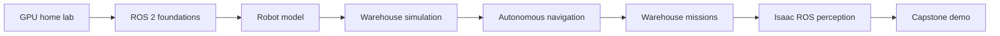

# Isaac ROS Home Lab: Full Learning Roadmap

[← Back to the main README](README.md)

This roadmap develops the project from a prepared Ubuntu workstation into a simulated autonomous warehouse robot. Each task produces a working, testable result and adds one concept at a time.

The infrastructure track follows the original Ubuntu + SSH + Docker + Isaac ROS + VNC setup checklist. The practical tasks below are an extended learning curriculum built on that environment.

## End goal

The capstone robot will be able to:

1. start at a virtual charging station;
2. receive a warehouse mission;
3. navigate to a requested shelf or station;
4. avoid static and moving obstacles;
5. use a simulated camera to verify its destination or detect an object;
6. report success or failure;
7. recover from selected navigation problems;
8. return to its home position.



## Recommended study method

For every task:

1. read the architecture diagram;
2. type the code instead of blindly pasting it;
3. build and run the smallest working version;
4. inspect nodes, topics, parameters, and transforms;
5. intentionally cause one failure and diagnose it;
6. complete the checklist;
7. commit the working state before continuing.

## Phase 0: Home-lab environment

### Task 00 — Prepare the Isaac ROS workstation

Build the foundation from the original setup document:

- Ubuntu 24.04 LTS;
- supported NVIDIA GPU and driver;
- Docker Engine and NVIDIA Container Toolkit;
- Isaac ROS CLI and development container;
- SSH access;
- optional VNC access for graphical tools;
- GPU verification on the host and inside Docker.

**Result:** a reproducible GPU-enabled development environment.

## Phase 1: ROS 2 foundations

### Task 01 — Publisher, topic, and subscriber

Use ROS 2 CLI tools to send and receive a typed string message.

**Concepts:** nodes, topics, publishers, subscribers, message types, ROS graph.

### Task 02 — Python temperature publisher

Create the `homelab_monitor` package and publish a simulated temperature once per second.

**Concepts:** `rclpy`, timers, callbacks, `Float32`, package entry points, `colcon`.

[Open Task 02](TASK-02-TEMPERATURE-PUBLISHER.md)

### Task 03 — Temperature monitor subscriber

Subscribe to the temperature topic and produce a warning above a configurable threshold.

**Concepts:** subscriber callbacks, parameters, runtime configuration, logging.

[Open Task 03](TASK-03-TEMPERATURE-MONITOR.md)

### Task 04 — Launch file and YAML configuration

Start both temperature nodes with one command and load parameters from a YAML file.

**Concepts:** ROS 2 launch, package resources, YAML configuration, process orchestration.

**Result of Phase 1:** a small multi-node ROS 2 application that is built, configured, launched, and inspected correctly.

## Phase 2: Robot fundamentals

### Task 05 — Robot coordinate frames

Learn the coordinate conventions used by mobile robots and publish a basic transform tree.

**Concepts:** `map`, `odom`, `base_link`, sensor frames, TF2, static and dynamic transforms.

### Task 06 — Build a wheeled robot model

Create a simple differential-drive rover with a chassis, four wheels, lidar, depth camera, and collision geometry.

**Concepts:** URDF, Xacro, links, joints, visual geometry, collision geometry, inertial properties.

### Task 07 — Display the robot in RViz

Load the robot description and inspect the model, coordinate frames, and sensor mounting positions graphically.

**Concepts:** RViz displays, RobotModel, TF visualization, fixed frames.

### Task 08 — Drive with velocity commands

Control the robot using `/cmd_vel`, first from the keyboard and then from a custom Python node.

**Concepts:** `geometry_msgs/msg/Twist`, linear velocity, angular velocity, teleoperation, safety stop.

**Result of Phase 2:** a graphical robot model with a correct frame tree and a defined movement interface.

## Phase 3: Simulation and sensors

### Task 09 — Create a warehouse world

Build a small simulation environment containing a floor, walls, shelving aisles, loading stations, and obstacles.

**Concepts:** simulator worlds, models, materials, collision objects, spawn positions.

### Task 10 — Simulate the mobile base

Connect wheel commands to the physics engine and publish odometry as the robot moves.

**Concepts:** differential drive, wheel joints, odometry, `/cmd_vel`, `/odom`.

### Task 11 — Add lidar and camera sensors

Publish simulated laser scans, images, camera calibration, and depth data.

**Concepts:** `LaserScan`, `Image`, `CameraInfo`, point clouds, sensor rates, noise.

**Result of Phase 3:** a drivable robot with realistic sensor topics inside a warehouse simulation.

## Phase 4: Autonomous navigation

### Task 12 — Visualize sensor data

Display lidar, camera, point cloud, odometry, and transforms together in RViz.

**Concepts:** sensor validation, frame alignment, timestamps, visualization debugging.

### Task 13 — Build a warehouse map

Drive the robot through the environment and create an occupancy-grid map using SLAM.

**Concepts:** SLAM, occupancy grids, map saving, scan matching, loop closure.

### Task 14 — Localize on a saved map

Restart the simulation and estimate the robot pose inside the previously saved map.

**Concepts:** localization, initial pose, particle filters, pose uncertainty.

### Task 15 — Navigate with Nav2

Send navigation goals from RViz and let the robot plan paths, follow them, and avoid obstacles.

**Concepts:** global and local costmaps, planners, controllers, recovery behavior, actions.

**Result of Phase 4:** the robot can autonomously reach selected positions in the warehouse.

## Phase 5: Warehouse autonomy

### Task 16 — Follow a waypoint route

Define named warehouse locations and make the robot visit several stations in sequence.

**Concepts:** waypoint navigation, pose lists, action clients, progress reporting.

### Task 17 — Implement a mission controller

Create a node that accepts jobs such as `inspect shelf B4` or `go to loading station` and tracks mission state.

Suggested states:

```text
IDLE → PLANNING → NAVIGATING → VERIFYING → COMPLETED
                     └────────→ RECOVERY → FAILED
```

**Concepts:** state machines, ROS actions, cancellation, timeouts, structured status messages.

### Task 18 — Handle warehouse failures

Detect and react to blocked aisles, navigation timeout, localization loss, and unavailable destinations.

**Concepts:** recovery strategies, retries, fallback goals, error reporting, safe stop.

**Result of Phase 5:** a robot that executes multi-step warehouse missions instead of accepting only individual navigation goals.

## Phase 6: Isaac ROS perception

### Task 19 — Build a camera processing pipeline

Validate image transport and create a GPU-accelerated Isaac ROS image-processing graph.

**Concepts:** image formats, resizing, rectification, composable nodes, GPU memory flow.

### Task 20 — Detect warehouse objects

Run object detection on simulated camera images and publish detections for boxes, pallets, signs, or selected custom classes.

**Concepts:** inference models, bounding boxes, confidence scores, detection messages.

### Task 21 — Connect perception to behavior

Use detections to verify a shelf or station and influence the mission controller.

**Concepts:** perception-to-planning interfaces, filtering, confidence thresholds, coordinate transforms.

**Result of Phase 6:** navigation decisions can use GPU-accelerated visual perception.

## Phase 7: Capstone

### Task 22 — Autonomous warehouse mission

Combine all previous components into one demonstration:

```text
Mission request
    ↓
Select destination
    ↓
Navigate through warehouse
    ↓
Avoid obstacles or recover
    ↓
Verify destination with camera
    ↓
Report mission result
    ↓
Return to home station
```

The final repository should include:

- robot description and meshes;
- warehouse simulation world;
- launch files and YAML configuration;
- navigation maps and parameters;
- mission controller source code;
- perception pipeline configuration;
- automated smoke tests;
- architecture diagrams;
- screenshots or a short demo video;
- setup and troubleshooting documentation.

## Optional extensions

After the capstone, possible extensions include:

- battery simulation and autonomous charging;
- multiple robots and traffic coordination;
- QR or AprilTag station identification;
- a web dashboard for missions and telemetry;
- rosbag recording and offline analysis;
- integration with a real mobile base;
- manipulator or lift attachment for physical load handling;
- CI checks for Python, launch files, and package metadata.

## Progress tracker

| Task | Deliverable | Status |
|---:|---|:---:|
| 00 | Isaac ROS workstation | Complete |
| 01 | CLI publisher/subscriber | Complete |
| 02 | Temperature publisher | Complete |
| 03 | Temperature monitor | Ready |
| 04 | Launch and YAML configuration | Planned |
| 05 | TF frame exercise | Planned |
| 06 | Wheeled robot URDF/Xacro | Planned |
| 07 | RViz robot visualization | Planned |
| 08 | `/cmd_vel` motion control | Planned |
| 09 | Warehouse simulation world | Planned |
| 10 | Simulated mobile base | Planned |
| 11 | Simulated lidar and camera | Planned |
| 12 | RViz sensor visualization | Planned |
| 13 | SLAM warehouse map | Planned |
| 14 | Localization | Planned |
| 15 | Nav2 autonomous navigation | Planned |
| 16 | Waypoint route | Planned |
| 17 | Mission controller | Planned |
| 18 | Failure recovery | Planned |
| 19 | Isaac ROS camera pipeline | Planned |
| 20 | Object detection | Planned |
| 21 | Perception-driven behavior | Planned |
| 22 | Autonomous warehouse demo | Planned |

Update this table after each completed and verified task.
