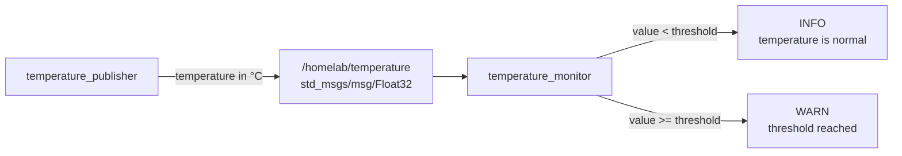

# Task 03: Build a ROS 2 Temperature Monitor

[← Back to the Isaac ROS Home Lab roadmap](README.md)

In this lab, you will add a custom subscriber to the `homelab_monitor` package. It listens to the temperature publisher from Task 02 and emits a warning when the temperature reaches a configurable threshold.

## What you will learn

- how to create a ROS 2 subscriber with `rclpy`;
- how subscriber callbacks process incoming messages;
- how to use ROS 2 parameters instead of hard-coded configuration;
- how to change a parameter at startup and while a node is running;
- how multiple custom nodes form a small ROS 2 application.

## Architecture



## Prerequisite

Complete [Task 02](TASK-02-TEMPERATURE-PUBLISHER.md) first. The following executable must work inside the Isaac ROS container:

```bash
ros2 run homelab_monitor temperature_publisher
```

## 1. Create the subscriber node

Open a terminal inside the Isaac ROS container:

```bash
isaac-ros activate
```

Create the monitor source file:

```bash
nano /workspaces/isaac_ros-dev/src/homelab_monitor/homelab_monitor/temperature_monitor.py
```

Add the following code:

```python
import rclpy
from rclpy.node import Node
from std_msgs.msg import Float32


class TemperatureMonitor(Node):

    def __init__(self):
        super().__init__('temperature_monitor')

        self.declare_parameter('warning_threshold', 70.0)

        self.subscription = self.create_subscription(
            Float32,
            '/homelab/temperature',
            self.handle_temperature,
            10,
        )

        threshold = self.get_warning_threshold()
        self.get_logger().info(
            f'Temperature monitor started; warning threshold: '
            f'{threshold:.1f} °C'
        )

    def get_warning_threshold(self):
        return self.get_parameter(
            'warning_threshold'
        ).get_parameter_value().double_value

    def handle_temperature(self, message):
        temperature = message.data
        threshold = self.get_warning_threshold()

        if temperature >= threshold:
            self.get_logger().warning(
                f'HIGH TEMPERATURE: {temperature:.1f} °C '
                f'(threshold: {threshold:.1f} °C)'
            )
        else:
            self.get_logger().info(
                f'Temperature OK: {temperature:.1f} °C '
                f'(threshold: {threshold:.1f} °C)'
            )


def main(args=None):
    rclpy.init(args=args)

    node = TemperatureMonitor()

    try:
        rclpy.spin(node)
    except KeyboardInterrupt:
        pass
    finally:
        node.destroy_node()
        rclpy.shutdown()


if __name__ == '__main__':
    main()
```

Save with `Ctrl+O`, confirm with Enter, and close Nano with `Ctrl+X`.

## 2. Check the Python syntax

```bash
python3 -m py_compile \
  /workspaces/isaac_ros-dev/src/homelab_monitor/homelab_monitor/temperature_monitor.py
```

No output means the syntax check passed.

## 3. Register the new executable

Open `setup.py`:

```bash
nano /workspaces/isaac_ros-dev/src/homelab_monitor/setup.py
```

The complete `console_scripts` section should now contain both nodes:

```python
entry_points={
    'console_scripts': [
        'temperature_publisher = homelab_monitor.temperature_publisher:main',
        'temperature_monitor = homelab_monitor.temperature_monitor:main',
    ],
},
```

## 4. Build the package

```bash
cd /workspaces/isaac_ros-dev

colcon build \
  --symlink-install \
  --packages-select homelab_monitor

source install/setup.bash
```

## 5. Run the complete application

Use two SSH terminals. Activate Isaac ROS and source the workspace in both terminals.

### Terminal 1: publisher

```bash
isaac-ros activate
source /workspaces/isaac_ros-dev/install/setup.bash
ros2 run homelab_monitor temperature_publisher
```

### Terminal 2: monitor

```bash
isaac-ros activate
source /workspaces/isaac_ros-dev/install/setup.bash
ros2 run homelab_monitor temperature_monitor
```

At lower temperatures, the monitor reports:

```text
Temperature OK: 62.8 °C (threshold: 70.0 °C)
```

When the simulated temperature reaches the threshold:

```text
HIGH TEMPERATURE: 71.8 °C (threshold: 70.0 °C)
```

Stop each node with `Ctrl+C`.

## 6. Override the threshold at startup

Start the monitor with a lower threshold:

```bash
ros2 run homelab_monitor temperature_monitor \
  --ros-args -p warning_threshold:=60.0
```

The source code remains unchanged. The node receives configuration through the ROS parameter system.

## 7. Inspect and change the parameter at runtime

Keep the publisher and monitor running. In a third terminal, activate Isaac ROS and source the workspace:

```bash
isaac-ros activate
source /workspaces/isaac_ros-dev/install/setup.bash
```

List the running nodes. Lyrical may require the daemon workaround:

```bash
ros2 node list --no-daemon
```

Inspect the configured threshold:

```bash
ros2 param get /temperature_monitor warning_threshold
```

Change it without restarting the node:

```bash
ros2 param set /temperature_monitor warning_threshold 65.0
```

The next incoming message uses the new value because the callback reads the parameter every time it processes a temperature.

## 8. Inspect the ROS graph

```bash
ros2 topic info --no-daemon /homelab/temperature
ros2 topic type /homelab/temperature
```

With both custom nodes running, expect one publisher and one subscriber:

```text
Type: std_msgs/msg/Float32
Publisher count: 1
Subscription count: 1
```

## Code walkthrough

### Declaring a parameter

```python
self.declare_parameter('warning_threshold', 70.0)
```

Every parameter must be declared before the node reads it. The second argument provides the default value.

### Creating a subscription

```python
self.subscription = self.create_subscription(
    Float32,
    '/homelab/temperature',
    self.handle_temperature,
    10,
)
```

The subscription must use the same topic name and compatible message type as the publisher. `handle_temperature` is called whenever a new message arrives.

### Reading current configuration

```python
threshold = self.get_warning_threshold()
```

Reading the parameter inside the callback allows runtime updates to affect the next message immediately.

## Completion checklist

- [ ] `temperature_monitor.py` passes the Python syntax check.
- [ ] The package builds without errors.
- [ ] Both custom executables are available through `ros2 run`.
- [ ] The monitor receives values from `/homelab/temperature`.
- [ ] Values below the threshold produce `INFO` messages.
- [ ] Values at or above the threshold produce `WARN` messages.
- [ ] `warning_threshold` can be overridden at startup.
- [ ] The parameter can be changed while the node is running.
- [ ] Topic information shows one publisher and one subscriber.

## Next task

Create a ROS 2 launch file that starts both nodes with one command and loads the warning threshold from a YAML configuration file.
